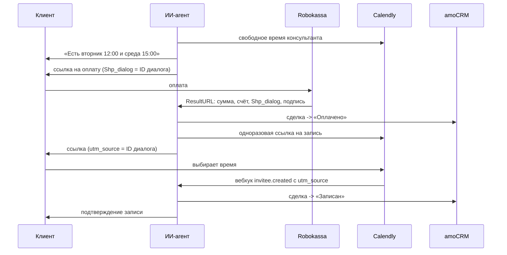

# Оплата и запись на консультацию из чата: Robokassa, Calendly, amoCRM

ИИ-агент в Telegram записывает клиента на платную консультацию без участия менеджера: показывает свободное время консультанта, выдаёт ссылку на предоплату, после оплаты присылает ссылку на запись, а сделка в amoCRM сама проходит этапы «Оплачено» и «Записан».

Код обезличен и переписан для публикации из рабочих функций агента на платформе NextBot. Логины, пароли магазина, токены и ID полей CRM удалены.

## Главная задача: вернуть событие в нужный диалог

Оплата и запись происходят вне чата, на страницах Robokassa и Calendly. Чтобы уведомление об оплате и о записи попало в диалог именно этого клиента, ID диалога едет вместе с клиентом:

- в ссылке на оплату это пользовательский параметр `Shp_dialog`, он входит в подпись и возвращается в уведомлении на ResultURL;
- в ссылке на запись это `utm_source`, Calendly возвращает его в вебхуке в `payload.tracking.utm_source`.

На платформе входящий вебхук превращается в сообщение диалога через адаптер, и агент продолжает разговор уже с фактом оплаты или записи.



## Что учтено

- **Подпись Robokassa.** Ссылка подписывается `MerchantLogin:OutSum:InvId:Пароль#1:Shp_...`, уведомление проверяется по `OutSum:InvId:Пароль#2:Shp_...`, пользовательские параметры в алфавитном порядке. Уведомление с чужой подписью отклоняется.
- **Повторные уведомления.** Robokassa повторяет уведомление, пока не получит `OK<InvId>`. Повтор по уже оплаченному счёту не двигает сделку и не шлёт клиенту вторую ссылку.
- **Номер счёта.** `InvId` в Robokassa ограничен 2 147 483 647; номер собирается из времени и хвоста ID диалога.
- **Запасной путь.** Если уведомление потерялось, статус запрашивается через XML API `OpStateExt`: код состояния 100 означает, что деньги зачислены.
- **Одноразовая ссылка.** Ссылка Calendly создаётся на одну встречу, чтобы по одной оплате нельзя было записаться дважды.
- **Модель не подтверждает запись раньше времени.** Ответы функций содержат инструкцию агенту: до оплаты запись не подтверждается, время называется только из списка свободных слотов.

Второй контур того же проекта, платная подписка на отдельного бота, собран на роботах amoCRM: после оплаты сделка переходит на этап подписки, бот отвечает только сделкам на этом этапе, а при окончании подписки робот выставляет новый счёт. Этот контур настраивается в CRM и в репозиторий не входит.

## Структура

```
flow/robokassa.py      ссылка на оплату, проверка ResultURL, статус через OpStateExt
flow/calendly.py       свободные слоты, одноразовая ссылка с ID диалога, разбор вебхука
flow/amocrm.py         перевод сделки на этап
flow/booking_flow.py   сценарий целиком: слоты, оплата, запись, этапы сделки
tests/                 подписи, повторные уведомления, привязка к диалогу
```

## Запуск тестов

```bash
pip install -r requirements-dev.txt
pytest
```
